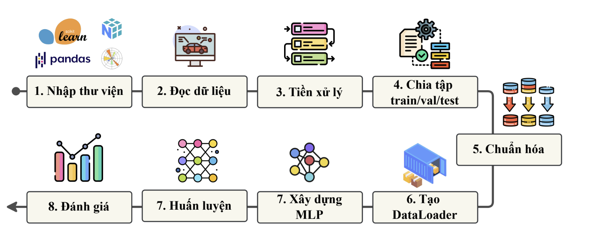
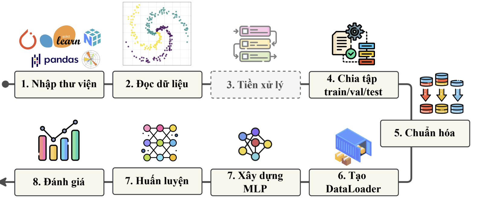
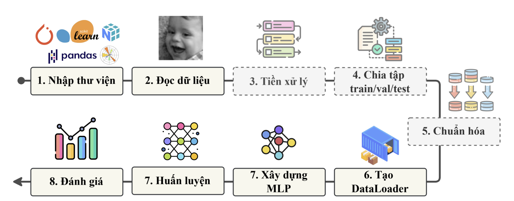

# Exercise for MLP — Thực hành Multi-layer Perceptron

Triển khai mạng **Multi-layer Perceptron (MLP)** bằng **PyTorch** cho ba bài toán: hồi quy mức tiêu thụ nhiên liệu xe hơi, phân loại dữ liệu phi tuyến và nhận diện cảm xúc khuôn mặt.

Nội dung dựa trên tài liệu **Exercise: Multi-layer Perceptron — AI VIET NAM, AI Course 2026**, của Dương Đình Thắng, Nguyễn Anh Khôi và Đinh Quang Vinh. Xem [đề bài PDF](data/%5BDescription_v2%5D-Exercise%20Multi-layer%20Perceptron.pdf) để biết yêu cầu chi tiết.

## Tổng quan

| Bài | Notebook | Bài toán | Trạng thái |
| --- | --- | --- | --- |
| 1 | [Auto_MPG_Prediction.ipynb](Auto_MPG_Prediction.ipynb) | Dự đoán MPG từ thông số xe | Đã có mã nguồn và kết quả chạy |
| 2 | [NonLinear.ipynb](NonLinear.ipynb) | Phân loại 3 lớp dữ liệu phi tuyến trong không gian 2D | Đã có mã nguồn và kết quả chạy |
| 3 | [FER.ipynb](FER.ipynb) | Nhận diện 7 cảm xúc khuôn mặt trên FER-2013 | Đã có mã nguồn và kết quả chạy |

Hai notebook đầu thực hiện quy trình chia dữ liệu train/validation/test, chuẩn hóa bằng `StandardScaler` chỉ fit trên tập train, tạo `Dataset`/`DataLoader`, xây dựng MLP, huấn luyện và đánh giá. Các lớp ẩn dùng ReLU; lớp đầu ra trả về giá trị hồi quy hoặc logits tùy bài toán.

## Cấu trúc thư mục

```text
Exercise-for-MLP/
├── README.md
├── .gitignore
├── Auto_MPG_Prediction.ipynb
├── NonLinear.ipynb
├── FER.ipynb
└── data/
    ├── auto-mpg.csv
    ├── NonLinear_data.npy
    ├── BAI1.png
    ├── BAI2.png
    ├── BAI3.png
    └── [Description_v2]-Exercise Multi-layer Perceptron.pdf
```

Dữ liệu ảnh FER (`data/archive.zip`, `data/train/`, `data/test/`) được giữ ở máy local và bỏ qua khi commit để tránh đưa bộ ảnh lớn vào lịch sử Git.

## Bài 1 — Dự đoán hiệu suất xe hơi (Auto MPG)



**Mục tiêu:** dự đoán `mpg` (Miles Per Gallon — số dặm đi được trên một gallon nhiên liệu) từ các thông số kỹ thuật của xe.

- Dữ liệu: [data/auto-mpg.csv](data/auto-mpg.csv), gồm 398 dòng trước khi xử lý.
- Đầu vào thực tế: 6 đặc trưng `cylinders`, `displacement`, `horsepower`, `weight`, `acceleration`, `model-year`.
- Tiền xử lý: loại các dòng thiếu dữ liệu, còn 396 mẫu; chia 277 mẫu train, 79 mẫu validation và 40 mẫu test, gần tỷ lệ 70/20/10.
- Kiến trúc: `6 → 64 → 64 → 1`, ReLU sau hai lớp ẩn.
- Huấn luyện: `MSELoss`, SGD với learning rate `0.01`, batch size `32`, `1000` epoch, seed `42`.
- Đánh giá: theo dõi MSE và R² trên train/validation, sau đó tính R² trên test.

**Kết quả được lưu trong notebook:** Test R² ≈ **0.8273**.

## Bài 2 — Phân loại dữ liệu phi tuyến



**Mục tiêu:** học ranh giới phân loại phi tuyến cho 3 lớp dữ liệu trong không gian hai chiều.

- Dữ liệu: [data/NonLinear_data.npy](data/NonLinear_data.npy), gồm `X` có kích thước `(300, 2)` và `labels` có kích thước `(300,)`.
- Chia dữ liệu: 210 mẫu train, 60 mẫu validation, 30 mẫu test; chuẩn hóa đặc trưng bằng `StandardScaler`.
- Kiến trúc: `2 → 128 → 3`, ReLU sau lớp ẩn; số lớp được xác định từ nhãn train.
- Huấn luyện: `CrossEntropyLoss`, SGD với learning rate `0.01`, momentum `0.9`, batch size `32`, `100` epoch, seed `42`.
- Đánh giá: loss và accuracy trên train/validation, accuracy trên test.

**Kết quả được lưu trong notebook:** Test Accuracy = **100.00%** trên **30 mẫu test**. Đây là kết quả của lần chạy đã lưu, với cách chia dữ liệu hiện tại.

## Bài 3 — Nhận diện cảm xúc khuôn mặt (FER-2013)



**Mục tiêu:** phân loại cảm xúc khuôn mặt bằng MLP sâu trên dữ liệu ảnh FER-2013, theo quy trình trong PDF.

- Phân loại 7 cảm xúc: `angry`, `disgust`, `fear`, `happy`, `neutral`, `sad`, `surprise`.
- Đọc ảnh grayscale, resize về `128 × 128`, chuẩn hóa bằng `(img / 127.5) - 1` về khoảng `[-1, 1]`.
- Tạo `ImageDataset` và mapping giữa tên cảm xúc với chỉ số nhãn; chia thư mục train thành train/validation theo tỷ lệ 80/20 với `stratify`, giữ tập test riêng.
- Flatten ảnh thành vector 16.384 chiều; kiến trúc MLP: `16384 → 256 → 128 → 64 → 7`, ReLU sau mỗi lớp ẩn.
- Cấu hình huấn luyện: `CrossEntropyLoss`, SGD với learning rate `0.01`, batch size `256`, `40` epoch, seed `59`.
- Trực quan hóa ảnh mẫu, loss/accuracy theo epoch và đánh giá accuracy trên tập test.

**Kết quả được lưu trong notebook:** Test Accuracy = **41.21%**, với 22.967 ảnh train, 5.742 ảnh validation và 7.178 ảnh test. Ở epoch cuối, train accuracy đạt 46.49% và validation accuracy đạt 40.53%.

## Cài đặt và chạy

### 1. Tải repository

```bash
git clone https://github.com/caoban123/Exercise-for-MLP.git
cd Exercise-for-MLP
```

### 2. Tạo môi trường Python

Ví dụ sử dụng Python 3.10 và môi trường ảo:

```bash
python -m venv .venv
```

Kích hoạt môi trường trên Windows PowerShell:

```powershell
.\.venv\Scripts\Activate.ps1
```

Hoặc trên macOS/Linux:

```bash
source .venv/bin/activate
```

Cài các thư viện cho hai notebook đã triển khai:

```bash
python -m pip install torch numpy pandas scikit-learn matplotlib jupyterlab ipykernel
```

Để chạy bài FER, cài thêm thư viện xử lý ảnh:

```bash
python -m pip install torchvision
```

Các lệnh trên chưa cố định phiên bản thư viện; repository hiện chưa có môi trường phụ thuộc được khóa phiên bản.

### 3. Mở notebook

```bash
python -m jupyterlab
```

Mở notebook cần chạy, chọn kernel của môi trường vừa tạo và chạy các cell từ trên xuống. Có thể mở bằng VS Code với extension Python và Jupyter. Riêng `FER.ipynb` cần chuẩn bị bộ ảnh trước khi chạy.

**Lưu ý khi chạy:**

- Chạy từ thư mục gốc repository để đường dẫn `data/` hoạt động đúng.
- Hai notebook đang dùng đường dẫn kiểu Windows (`data\\auto-mpg.csv`, `data\\Nonlinear_data.npy`). Trên macOS/Linux, sửa thành `data/auto-mpg.csv` và `data/NonLinear_data.npy`; tên file NumPy cần khớp chữ hoa/thường.
- Bài NonLinear chuyển batch sang `device` nhưng chưa chuyển model. Nếu chạy trên CUDA/MPS, thêm `model = model.to(device)` sau khi khởi tạo model và trước khi tạo optimizer, hoặc chọn CPU bằng `get_device("cpu")`.
- Để chuẩn bị dữ liệu FER sau khi clone, tải bộ dữ liệu theo liên kết trong phụ lục PDF và đặt ảnh theo cấu trúc `data/train/<tên_cảm_xúc>/` và `data/test/<tên_cảm_xúc>/`.

## Đối chiếu với đề bài

README mô tả đúng cấu hình trong mã nguồn hiện tại. Một số thiết lập khác với cấu hình mẫu trong PDF:

| Thiết lập | PDF | Notebook hiện tại |
| --- | --- | --- |
| Seed bài 1 và 2 | 59 | 42 |
| Số đặc trưng Auto MPG trong bảng tổng quan | 9 | 6 theo CSV đi kèm |
| Số epoch Auto MPG | 100 | 1000 |
| SGD bài NonLinear | Learning rate 0.1 | Learning rate 0.01, momentum 0.9 |

Các chỉ số kết quả ở trên được đọc từ output đã lưu trong notebook, chưa phải kết quả chạy lại trong một môi trường mới. Ba ảnh PNG minh họa quy trình thực hiện từng bài, không phải biểu đồ kết quả huấn luyện.

## Tài liệu

- [Exercise: Multi-layer Perceptron — AI VIET NAM, AI Course 2026](data/%5BDescription_v2%5D-Exercise%20Multi-layer%20Perceptron.pdf).
- Các hình minh họa quy trình: `data/BAI1.png`, `data/BAI2.png`, `data/BAI3.png` đi kèm thư mục bài tập.
